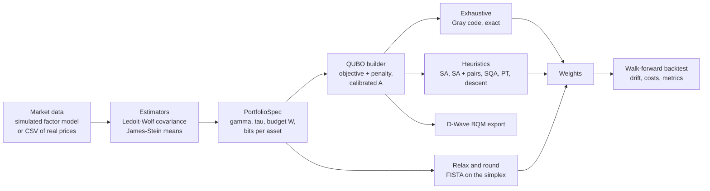
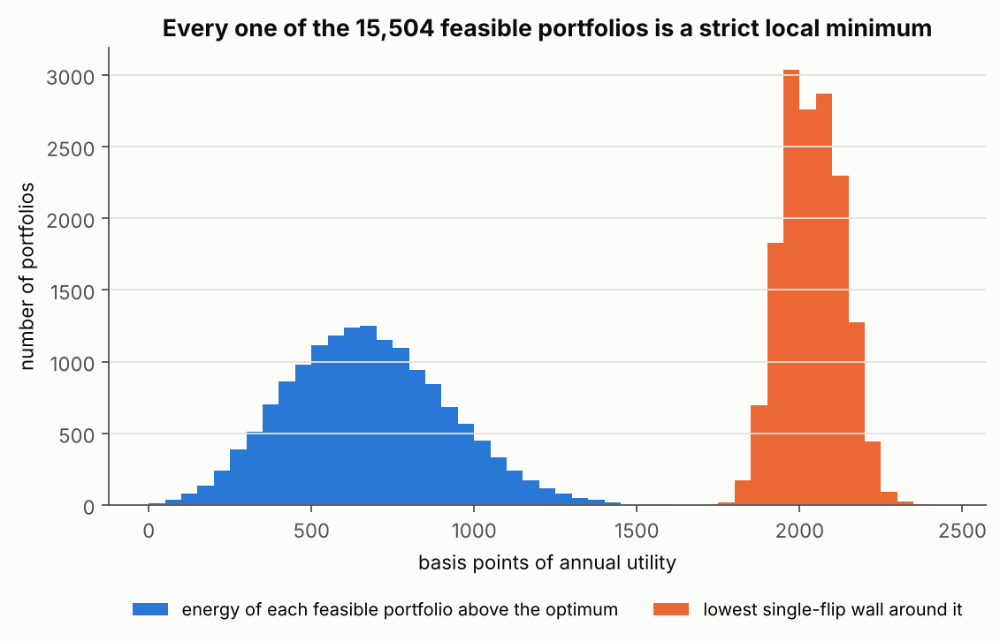
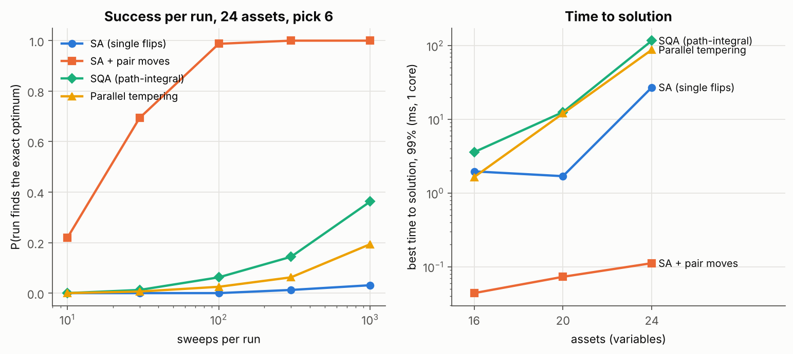
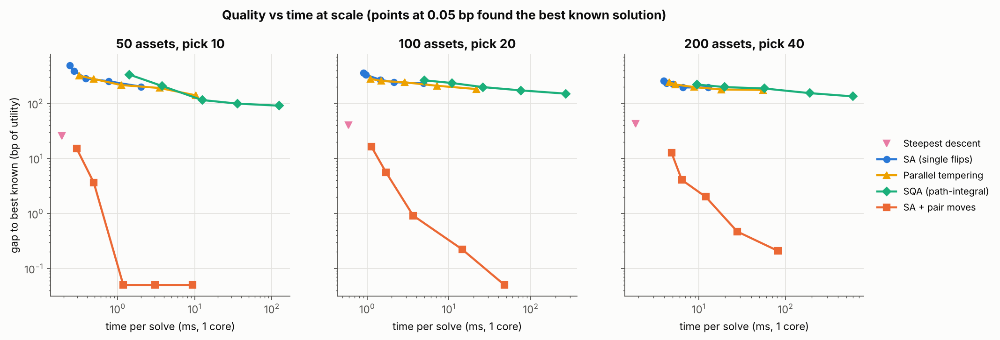
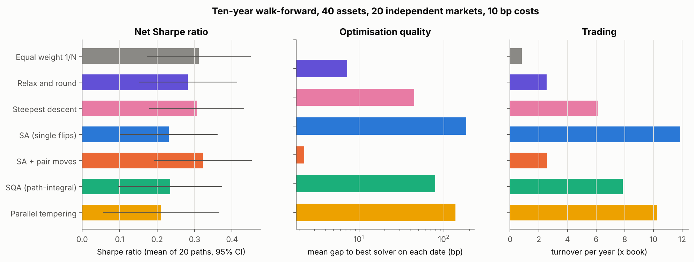
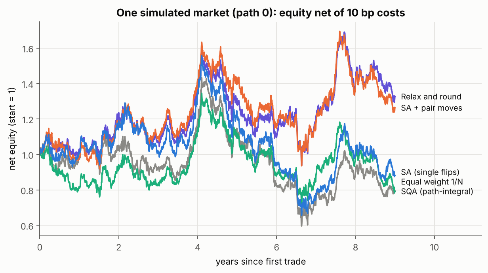
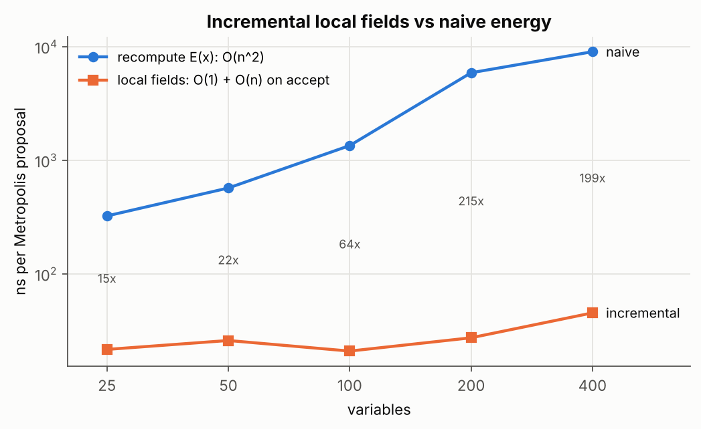

# qubo-alloc

**Cardinality-constrained portfolio construction as a QUBO, solved by simulated quantum annealing and the strongest classical heuristics, then tested in a ten-year walk-forward backtest. C++20, OpenMP, no dependencies.**

"Portfolio optimisation on a quantum annealer" is one of the most quoted use cases of quantum computing in finance. This project builds the whole chain a desk would need to judge that claim:

1. estimate risk and return honestly (Ledoit-Wolf, James-Stein, no look-ahead);
2. write the selection problem as a QUBO, the native input of D-Wave machines;
3. solve it with a path-integral simulation of quantum annealing (SQA) and with classical competitors, against exact optima;
4. trade the result through a walk-forward backtest with costs, over 20 independent markets.

The answer is more nuanced than either the hype or the dismissal, and every number behind it is reproducible from this repository.

---

## Headline results

| Finding | Evidence |
|---|---|
| **The penalty formulation creates a golf-course landscape.** All 15,504 feasible portfolios of a 20-asset, pick-5 instance are strict local minima, surrounded by walls of at least 1,755 bp, while the 10% closest portfolios lie within 362 bp of the optimum. | `landscape.png` |
| **On that landscape, SQA beats classical single-flip dynamics per sweep.** At 24 assets and 1,000 sweeps, a run finds the exact optimum with probability 36% for SQA, against 19% for parallel tempering and 3% for simulated annealing. | `tts.png` |
| **In wall-clock time the advantage disappears.** The 32 Trotter slices cost 32 times the work; best time to solution at 24 assets: SA 27 ms, PT 88 ms, SQA 117 ms. | `tts.csv` |
| **The formulation beats the solver.** Classical annealing with pair moves (which keep the cardinality fixed) reaches the optimum in 0.11 ms, 1,000 times faster than SQA, and stays within 0.2 bp of the best known solution at 200 assets. | `scaling.png` |
| **Solver quality reaches the P&L through turnover.** Weak solvers land on a different near-optimal portfolio at every date: 8 to 12 times the book traded per year instead of 2.6. Over 20 markets this costs 0.08 to 0.10 Sharpe against 1/N (paired t = -2.0 to -2.7). | `backtest.png` |
| **Optimisation does not buy Sharpe here, it buys risk control.** No method beats 1/N on Sharpe with significance. The well-solved portfolios cut volatility from 17.1% to 15.1% and the average max drawdown from 40.7% to 34.6%. | `backtest_metrics.csv` |
| **Incremental local fields make the heuristics 15 to 215 times faster** than recomputing the energy. | `perf.png` |

---

## Architecture



| File | Role |
|---|---|
| `market.cpp` | Factor model with GARCH(1,1) market volatility, Student-t shocks, sector factors and slowly mean-reverting alphas; CSV loader for real data. |
| `estimators.cpp` | Sample covariance, Ledoit-Wolf (2004) shrinkage, positive-part James-Stein means. |
| `qubo.cpp` | QUBO and Ising models, portfolio formulation with multi-bit weights, penalty calibration. |
| `solvers/` | Exhaustive enumeration, SA (with optional pair moves), SQA, parallel tempering, steepest descent, energy-scale calibration. |
| `backtest.cpp` | Walk-forward engine, simplex projection, relax-and-round, budget repair, metrics. |
| `main.cpp` | `demo`, `bench`, `backtest`, `perf`, `export`. |

## The model

Each asset gets `b` bits encoding an integer number of units `u_i`, and the weight is `w_i = u_i / W` for a budget of `W` units. With `b = 1` this is the classic "pick exactly K names, equally weighted".

```text
minimise   gamma w' Sigma w  -  mu' w  +  tau ||w - w_prev||^2  +  A (sum_i u_i - W)^2
```

- `Sigma`: Ledoit-Wolf covariance on a 252-day window. `mu`: James-Stein shrunk means. Both annualised, both computed from data strictly before the rebalance date (a test scrambles the future and checks that decisions do not move).
- The turnover term is quadratic, like a market-impact cost. For `b = 1` it is exactly linear because `x^2 = x`, so the problem stays a QUBO without auxiliary variables.
- **Penalty calibration.** Flipping bit p changes the objective by at most `B_p = |h_p| + sum_q |J_pq|`. With `A = 1.1 max_p B_p`, no single flip out of a feasible point can lower the energy, so the optimum is feasible. A test checks this on every instance. The same argument is why the landscape becomes a golf course.


## The solvers

| Solver | Moves | Idea |
|---|---|---|
| Exhaustive | Gray code | 2^n states, one O(n) field update each; ground truth up to 32 variables. |
| SA | single flips | Metropolis, geometric cooling, calibrated from the landscape. |
| SA + pair moves | single + (1 to 0, 0 to 1) pairs | Kawasaki dynamics: walks along the feasible set instead of over the walls. |
| SQA | single flips per slice + global flips | Suzuki-Trotter path integral: P = 32 replicas coupled by `J_perp = -(PT/2) ln tanh(Gamma / PT)`; the transverse field Gamma decreases linearly, as on D-Wave hardware. |
| Parallel tempering | single flips + replica swaps | 16 temperatures on a geometric ladder. |
| Steepest descent | single flips | Random restarts, the floor. |
| Relax and round | continuous | FISTA on the simplex, largest-remainder rounding to the unit grid. |

Every MCMC solver keeps the local fields `f_i = h_i + sum_j J_ij x_j` up to date. A proposal then costs O(1) and an accepted flip O(n), instead of O(n^2) for an energy recomputation. Restarts run in parallel with OpenMP, each on its own stream `Rng::stream(seed, r)`, so results do not depend on the thread count (tested).

**Calibration, not hand-tuning.** Temperatures and fields are read off the instance. The wall height is the median single-flip move out of a local minimum, and the fine scale is a low quantile of pair moves at local minima. The SQA operating point (P T = 0.3 x wall, Gamma_0 = 3 x wall) comes from a grid search on instances with known optima. It sits on a plateau, with a cliff to zero success below P T = 0.1 x wall, which the comments document.

---

## Results in detail

### 1. Why this problem is hard for single-flip dynamics



For one 20-asset, pick-5 instance, the exact energy of every feasible portfolio above the optimum (blue), and the lowest single-flip move out of each (orange). The two distributions do not even overlap. Every feasible portfolio is a strict local minimum, and moving between two of them means crossing a wall higher than the entire spread of the objective: the lowest wall is 1,755 bp, while the best and worst feasible portfolios are only 1,576 bp apart. The median wall (2,036 bp) is three times the median distance to the optimum (662 bp). This is not specific to this instance; it follows from the penalty calibration above.

### 2. Time to solution against the exact optimum



10 instances per size, 16 runs per instance and setting, one core, so that wall time is CPU time. TTS99 is the time to reach the optimum with 99% confidence by independent repetitions, `t ln(0.01) / ln(1 - p)` (Ronnow et al., *Science* 2014), at the best sweep budget for each solver.

- Per run, SQA is the best single-flip method, and the gap grows with size. That is the expected signature of tunnelling through tall, thin barriers: the replicas let part of the path sit on the other side of a wall.
- Per millisecond, SQA's 32 slices are a 32-fold cost, and it ends up no faster than PT or SA.
- Pair moves make the walls irrelevant. With the right move set, a classical annealer solves the problem 1,000 times faster than any wall-crossing method.

### 3. At scale



50 to 200 assets, with no exact answer. The gap is in basis points of annual utility, against the best solution found by any method with a large budget. At 1,000 sweeps, single-flip SA, PT and SQA still sit 90 to 230 bp from the best, worse than plain steepest descent (26 to 43 bp). SA with pair moves reaches the best known solution at 50 and 100 assets and is within 0.2 bp at 200 assets, in about 100 ms.

### 4. Walk-forward backtest



40 assets, ten years, monthly rebalancing into 8 names, 10 bp costs, repeated on 20 independent simulated markets:

| Method | Sharpe | CAGR | Vol | Max DD | Turnover / yr | Gap to best solver (bp) | Dates at best |
|---|---|---|---|---|---|---|---|
| Equal weight 1/N | 0.311 | 4.34% | 17.05% | 40.7% | 0.8 | - | - |
| Relax and round | 0.283 | 3.43% | 15.14% | 35.3% | 2.6 | 7.2 | 46% |
| Steepest descent | 0.305 | 3.84% | 15.34% | 35.0% | 6.1 | 44.6 | 4% |
| SA (single flips) | 0.231 | 2.70% | 16.08% | 40.3% | 11.9 | 183.6 | 0% |
| **SA + pair moves** | **0.322** | 4.03% | 15.11% | **34.6%** | 2.6 | **2.3** | **75%** |
| SQA | 0.235 | 2.77% | 15.60% | 38.2% | 7.9 | 79.0 | 0% |
| Parallel tempering | 0.211 | 2.41% | 15.80% | 40.8% | 10.3 | 136.1 | 0% |

Sharpe standard errors are about 0.07 across paths. Paired against 1/N on the same markets, the differences are:

| Method | Sharpe - Sharpe(1/N) | t |
|---|---|---|
| SA + pair moves | +0.011 +/- 0.036 | +0.31 |
| Steepest descent | -0.006 +/- 0.035 | -0.17 |
| Relax and round | -0.028 +/- 0.040 | -0.72 |
| SQA | -0.076 +/- 0.036 | -2.14 |
| SA (single flips) | -0.080 +/- 0.040 | -1.98 |
| Parallel tempering | -0.101 +/- 0.037 | -2.74 |

Two lessons a PM would recognise:

- **Mean-variance with estimated inputs does not beat 1/N on Sharpe** (DeMiguel, Garlappi and Uppal, 2009). It does deliver what the risk term asks for: two points less volatility and six points less drawdown.
- **A noisy optimiser is a turnover generator.** When the solver lands on a different near-optimum every month, the book churns for no economic reason and costs eat the return. On this metric, optimisation quality has a measurable price.



### 5. Engineering



Cost of one Metropolis proposal: 21 to 45 ns with local fields, against 320 ns to 9 us when recomputing the energy, a 15x to 215x speedup.

---

## Design decisions

- **Benchmark against exact optima first.** Up to 24 assets the Gray-code enumerator gives the true answer, so "success" means the optimum, not "the best any of my heuristics found".
- **Time to solution on one core.** Solvers parallelise differently: SQA over slices, PT over replicas. Measuring single-thread wall time is the only fair comparison.
- **Realistic instances, not random couplings.** Benchmarks use the QUBOs the backtest actually produces: one dominant market mode, sector blocks, a penalty that dwarfs the objective. Random spin glasses would say nothing about this use case.
- **SA with pair moves is reported next to plain SA.** Hardware annealers only flip single spins, so plain SA is the like-for-like classical baseline for SQA. Pair moves are what a classical engineer would actually ship. Reporting both separates "quantum vs classical dynamics" from "good vs bad formulation".
- **Multiple markets, paired statistics.** One ten-year path is one draw. Differences of a few Sharpe points are invisible on one path and clear with 20 paired paths.
- **Strict warnings, sanitizers.** Compiled with `-Wall -Wextra -Wpedantic -Wshadow -Wconversion -Werror`, and the test suite passes under AddressSanitizer and UndefinedBehaviorSanitizer.

## Limitations

- The market is simulated. The generator has realistic features (volatility clustering, fat tails, sector structure, weak and decaying alpha) and was checked across seeds. For real data, use `--data prices.csv --prices 1`.
- SQA is a classical simulation. It mimics the equilibrium physics of a quantum annealer, not its real-time dynamics, its noise or its limited connectivity (embedding a dense 40-variable QUBO on a Pegasus graph costs chains of several qubits per variable).
- The QUBO has no box or sector constraints. Each would add penalty terms and make the golf-course effect stronger.

---

## Usage

```bash
cmake -S . -B build -DCMAKE_BUILD_TYPE=Release
cmake --build build -j
./build/qubo_tests                       # 24 tests

./build/qubo-alloc demo --assets 24 --units 6         # every solver vs the exact optimum
./build/qubo-alloc demo --assets 12 --units 9 --bits 2  # multi-bit weights
./build/qubo-alloc bench --instances 10 --out results   # landscape, TTS, scaling
./build/qubo-alloc backtest --paths 20 --out results    # walk-forward on 20 markets
./build/qubo-alloc backtest --data prices.csv --prices 1  # your own data
./build/qubo-alloc perf --out results
./build/qubo-alloc export --assets 20 --units 5 --out portfolio_bqm.json
python3 scripts/plot_results.py results docs

# Sanitizer build
cmake -S . -B build-asan -DCMAKE_BUILD_TYPE=Debug -DQUBO_SANITIZE=ON && cmake --build build-asan -j && ./build-asan/qubo_tests
```

Sending an exported instance to a D-Wave sampler:

```python
import json, dimod
from dwave.system import DWaveSampler, EmbeddingComposite
d = json.load(open("portfolio_bqm.json"))
bqm = dimod.BinaryQuadraticModel(
    {int(k): v for k, v in d["linear"].items()},
    {(i, j): c for i, j, c in d["quadratic"]},
    d["offset"], dimod.BINARY)
result = EmbeddingComposite(DWaveSampler()).sample(bqm, num_reads=1000)
```

Example output of `demo` (24 assets, pick 6):

```text
solver             objective      gap (bp)   feasible   time (ms)   holdings
exhaustive         -0.593725          0.00        yes        82.4   1 4 6 10 18 20
descent            -0.592967          7.58        yes         0.1   1 4 8 10 18 20
sa                 -0.573143        205.82        yes         0.5   1 4 6 8 10 16
sa-pair            -0.593725          0.00        yes         2.1   1 4 6 10 18 20
sqa                -0.593725          0.00        yes        31.7   1 4 6 10 18 20
pt                 -0.593725          0.00        yes        10.8   1 4 6 10 18 20
relax-round        -0.592967          7.58        yes         0.0   1 4 8 10 18 20
```

## Test coverage

| Area | What is checked |
|---|---|
| Model | Local fields stay equal to a from-scratch recomputation over 5,000 flips; the Ising mapping preserves all 1,024 energies; the QUBO energy equals objective plus penalty for every bit pattern, with 1 to 3 bits per asset; the exact optimum is feasible and a strict local minimum |
| Estimators | Ledoit-Wolf closer to the truth than the sample covariance when T is close to N, positive definite, almost no shrinkage with abundant data; James-Stein shrinks pure noise hard |
| Data | Simulated market volatility and fat tails; CSV round trip; malformed CSV reported with the line number |
| Solvers | Exhaustive equals naive enumeration; SA + pairs, SQA and PT find the exact optimum on 8 instances; single-flip SA is trapped while pair moves are not; same seed gives the same answer whatever the thread count |
| Backtest | No look-ahead (the future is scrambled, decisions do not move); equity equals compounded returns; first trade is 100% of the book; cardinality held at every date; costs lower returns; simplex projection, rounding and budget repair |

## References

- Martonak, Santoro, Tosatti. *Quantum annealing by the path-integral Monte Carlo method: the two-dimensional random Ising model.* PRB 66, 094203 (2002).
- Ronnow et al. *Defining and detecting quantum speedup.* Science 345, 420 (2014).
- Ledoit, Wolf. *A well-conditioned estimator for large-dimensional covariance matrices.* JMVA 88, 365 (2004).
- DeMiguel, Garlappi, Uppal. *Optimal versus naive diversification: how inefficient is the 1/N portfolio strategy?* RFS 22, 1915 (2009).
- Lucas. *Ising formulations of many NP problems.* Frontiers in Physics 2, 5 (2014).
- Duchi, Shalev-Shwartz, Singer, Chandra. *Efficient projections onto the l1-ball for learning in high dimensions.* ICML (2008).
- Beck, Teboulle. *A fast iterative shrinkage-thresholding algorithm for linear inverse problems.* SIAM J. Imaging Sciences 2, 183 (2009).


